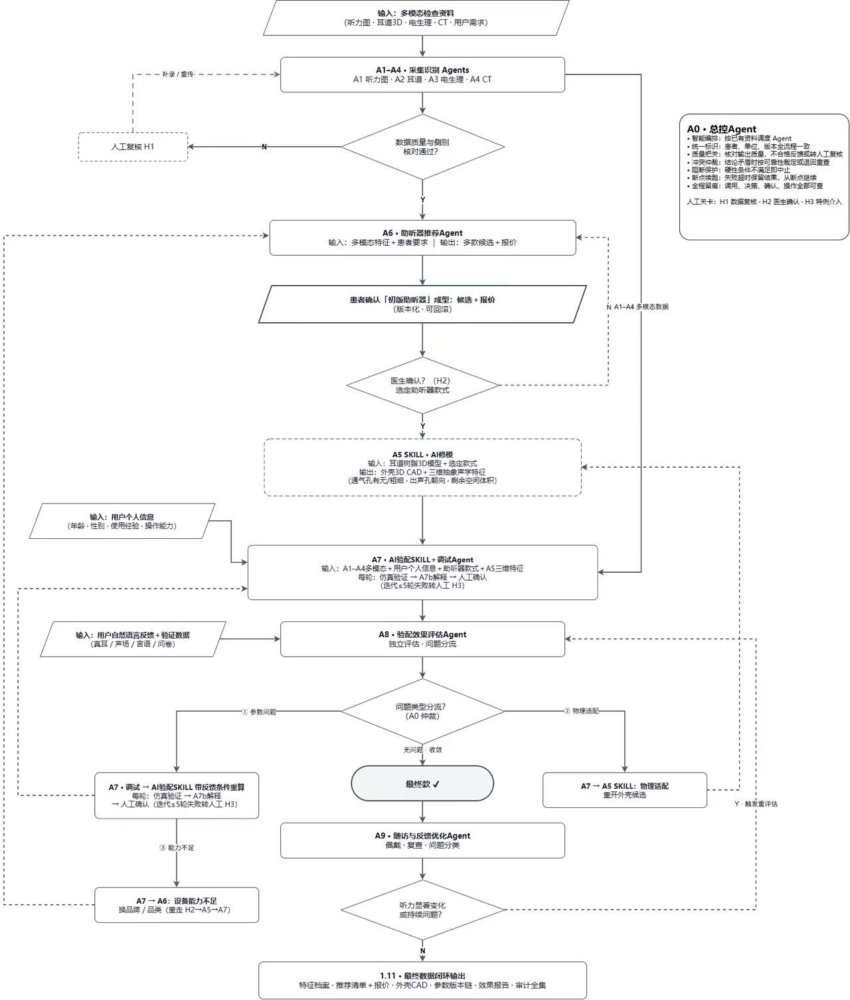

# 多智能体协作学习笔记（Multi-Agent Systems Study Notes）

本仓库记录多智能体协作（Multi-Agent Systems, MAS）领域的学术前沿论文、科技界工程实践动态，以及面向“基于听力学多模态特征的多 Agent 联动方法（A0至A9）”课题的架构映射与开发规范。

内容来源覆盖两条主线：一是 2024 至 2026 年顶会与预印本论文（UC Berkeley、MIT、Stanford、Johns Hopkins、清华大学等团队在多智能体失效分类学、医疗多智能体决策、裁判模型上的实证研究）；二是工业界一线工程报告与开源协议演进（Anthropic 多智能体研究系统工程复盘、OpenAI Agents SDK、LangGraph 状态机、AutoGen v0.4 异步事件架构、MCP 与 A2A 双层协议栈）。

## 目录索引

| 编号 | 笔记文件 | 核心主题 | 关联课题模块 |
| :--- | :--- | :--- | :--- |
| 01 | [notes/01-failure-taxonomy-and-verification.md](notes/01-failure-taxonomy-and-verification.md) | 多智能体失效分类学（MAST 14类失效）与 Agent-as-a-Judge 轨迹验证 | A0 质量把关、A7 5轮迭代上限、H1/H3 人工关卡、暑期审核验配 Agent |
| 02 | [notes/02-medical-multi-agent-benchmarks.md](notes/02-medical-multi-agent-benchmarks.md) | 医疗多智能体自适应编排（MDAgents）与模拟临床问诊评测（AgentClinic） | A0 冲突仲裁、多模态特征融合、模拟医生问诊评测 API 联调 |
| 03 | [notes/03-industry-orchestration-and-protocols.md](notes/03-industry-orchestration-and-protocols.md) | 工业界编排实践（Anthropic 主从架构、OpenAI Handoffs/Guardrails）与 MCP/A2A 协议栈 | A0 断点续跑、A5/A7 Skill 封装边界、跨模块文件交换与 API 契约 |
| 04 | [notes/04-audiology-a0-orchestrator-design.md](notes/04-audiology-a0-orchestrator-design.md) | 听力学多模态多 Agent 系统（A0至A9）总控设计规范与多智能体写作模式清单 | A0 总控状态机、H1/H2/H3 关卡、三路问题分流（参数/物理/设备能力） |

## 核心参考文献与工程信源

### 1. 学术论文（Papers）
* **MAST 失效分类学**：Mert Cemri et al. (UC Berkeley), *Why Do Multi-Agent LLM Systems Fail?*, arXiv:2503.13657, 2025.
* **Agent-as-a-Judge**：Mingchen Zhuge et al. (KAUST / Meta), *Agent-as-a-Judge: Evaluate Agents with Agents*, arXiv:2410.10934, 2024/2025.
* **MDAgents 医疗自适应协同**：Yubin Kim et al. (MIT Media Lab), *MDAgents: An Adaptive Collaboration of LLMs for Medical Decision-Making*, NeurIPS 2024 (arXiv:2404.15155).
* **AgentClinic 模拟问诊基准**：Samuel Schmidgall et al. (Johns Hopkins / Stanford), *AgentClinic: A Multimodal Agent Benchmark to Evaluate AI in Simulated Clinical Environments*, arXiv:2405.07960, 2024/2025.
* **Agent Hospital 医院全流程仿真**：Junkai Li et al. (Tsinghua University), *Agent Hospital: A Simulacrum of Hospital with Evolvable Medical Agents*, arXiv:2405.02957, 2024/2025.

### 2. 科技界动态与工程报告（Tech News & Engineering Blogs）
* **Anthropic Engineering (2025.06)**：*How we built our multi-agent research system*（披露 Claude Research 的 Lead-Subagent 架构、15倍 Token 消耗规律、外部记忆持久化与断点恢复机制）。
* **OpenAI Agents SDK (2025.03)**：由实验性框架 Swarm 演进为生产级 SDK，收敛出 `Agents`、`Handoffs`（控制权交接）、`Guardrails`（并行安全护栏）与 `Tracing` 四项原语，并原生接入 MCP。
* **Google A2A Protocol (2025.04)**：联合 50 余家企业发布 Agent2Agent 协议，通过 `/.well-known/agent.json`（Agent Card）解决跨框架不透明 Agent 的能力发现、长任务流式状态同步与 Artifact 交换。
* **Microsoft AutoGen v0.4 / AG2 & LangGraph**：从早期同步对话循环转向异步事件驱动 Actor 模型与显式图状态机（Graph State Machine），强化人类在环（Human-in-the-Loop）中断与状态回滚。

## 课题架构映射速查

本学习笔记直接服务于“多 Agent 协作的助听器验配系统”课题开发，关键工程映射如下：

1. **防死循环与有界迭代**：依据 MAST 对终止条件失效的实证结论，在 A7（AI 验配与调试 Agent）中强制设置最多 5 轮的仿真验证上限（迭代不超过 5 轮），超时或未收敛直接转交人工关卡 H3。
2. **Agent 与 Skill 职责解耦**：遵循 MCP 垂直工具调用与 A2A 水平协同的边界划分，将确定性高、输入输出固定的“AI 修模（A5）”与“AI 验配核心算法（A7 V5）”封装为标准化 Skill；将需要多源证据权衡的推荐（A6）、评估分流（A8）与总控（A0）实现为 Agent。
3. **双阶段裁判与问诊评测联调**：借鉴 AgentClinic 与 Agent-as-a-Judge 思路，将暑期完成的“审核验配 Agent”通过 API 接入同事负责的模拟医生问诊评测流，先执行数据完整性与侧别逻辑审核，再调用 V5 验配引擎输出基准方案。

## 维护规范

本仓库文档遵循平实技术语域：禁止使用句中破折号充当解释连接符，禁止堆砌营销词汇与装饰性图标，所有架构判断均需绑定具体论文实验数据或代码接口契约。
