# 多智能体协作系统（Multi-Agent Systems）原理与工程教科书

这是一份从第一性原理出发编写的多智能体系统（Multi-Agent Systems, MAS）技术讲义。

很多关于多智能体的教程停留在“给三个大模型分别写上产品经理、程序员、测试员的 System Prompt，再把它们塞进一个群聊循环”的表层玩法。一旦进入真实工程环境，这种粗糙的拼接会立刻撞上四堵墙：Token 账单呈平方级爆炸、长链路交接后上下文严重失真、多个同源模型在群聊中互相迎合放大幻觉、中间某一步调错外部接口后整个系统卡死且无法回滚。

要真正掌握多智能体协作，必须先跳出单一业务工程，把多智能体系统拆解为四个基础学科的交叉产物：**信息论与上下文压缩**、**分布式系统与容错状态机**、**图论与动态通信拓扑**、**社会选择理论与博弈裁决**。本仓库结合 2024 至 2026 年学术界代表性论文（ICLR、ICML、NeurIPS、COLM）与工业界生产实践（Anthropic、OpenAI、LangChain、Microsoft AutoGen、Google），用 8 个章节与 10 张原创架构图系统梳理这套知识体系。

## 全书章节导航

* **第一章：第一性原理与信息论边界（为什么单智能体会撞墙？）**
* **第二章：从经典分布式人工智能（DAI）到现代认知架构（CoALA）**
* **第三章：多智能体六大通信拓扑与动态图剪枝算法（DyLAN / AgentPrune / MacNet）**
* **第四章：群体动力学、多智能体辩论（MAD）病理学与证据裁决机制**
* **第五章：多智能体上下文工程与状态隔离机制（Scoped State & Reducers）**
* **第六章：为什么多智能体系统会崩溃？MAST 失效分类学与分布式容错工程**
* **第七章：2025 至 2026 四大主流生产框架运行时与双层开放协议栈（MCP + A2A）**
* **第八章：智能体评测科学（从静态刷榜到 $\text{pass}^k$ 可靠性悬崖与 Agent-as-a-Judge）**

## 第一章：第一性原理与信息论边界（为什么单智能体会撞墙？）

在决定动手搭建多智能体系统之前，必须先回答一个根本问题：**既然今天的基础模型已经拥有 200K 甚至 1M Token 的超长上下文窗口，为什么不把所有文档、所有工具和所有指令全部塞给一个超级单智能体（Monolithic Agent），而非要拆成多个智能体？**

答案并不在于“窗口装不下”，而在于 Transformer 架构的注意力稀释定律、工具空间的组合爆炸以及串联推理的误差累积特性。

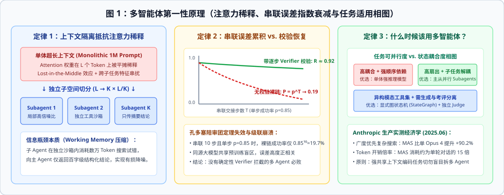

### 1.1 上下文窗口不等于有效工作记忆：注意力熵增与子空间隔离

在自注意力机制（Self-Attention）中，给定查询向量 $q_i$，其对上下文序列长度为 $L$ 的键值向量 $\{k_j\}_{j=1}^L$ 的注意力权重由 Softmax 归一化决定：

$$\alpha_{ij} = \frac{\exp(q_i^\top k_j / \sqrt{d_k})}{\sum_{m=1}^{L} \exp(q_i^\top k_m / \sqrt{d_k})}$$

当我们将 $K$ 个异构子任务的历史草稿、网页抓取原文、报错堆栈和几十个工具的 JSON Schema 全部堆叠进同一个长度为 $L$ 的上下文窗口时，分母中的求和项随着 $L$ 线性增长，导致注意力分布的香农熵 $H(\alpha_i) = -\sum_{j=1}^L \alpha_{ij} \log \alpha_{ij}$ 被迫升高。这种现象在工程上表现为两个直接后果：

1. **中间迷失效应（Lost-in-the-Middle, Liu et al., TACL 2024）**：模型对位于序列首尾的 Token 赋予显著更高的注意力权重，而对夹在中间数万 Token 搜索日志里的关键约束条件检出率大幅下滑。
2. **跨子任务特征串扰（Cross-Task Interference）**：前一个子任务留下的长篇推理轨迹会改变后续生成的条件概率分布，甚至诱导模型在调取第 $B$ 类工具时混入第 $A$ 类工具的参数格式。

从信息论视角看，**多智能体架构中的子智能体（Subagent）本质上是一个有损信息压缩算子（Information Bottleneck Operator）**。当主控智能体将一项子任务委派给独立的子智能体时，子智能体在自己独占的干净沙箱内消耗 $20,000$ Token 完成网页翻阅、代码调试或文献比对，随后将中间试错噪声全部丢弃，仅向主控返回 $300$ Token 的高信噪比结构化结论。主控智能体的工作记忆复杂度由此从 $O(K \cdot L_{\text{raw}})$ 降至 $O(K \cdot L_{\text{summary}})$。

### 1.2 串联误差指数衰减与孔多塞陪审团定理悖论

拆分为多智能体虽然解决了单窗口注意力稀释，却立刻引入了第二个数学陷阱：**交接链路的串联误差累积**。

假设一个复杂任务被拆解为 $T$ 个串行执行的智能体节点，每个节点的单步独立成功率为 $p \in (0, 1)$。如果节点之间没有中间校验机制（裸链交接），整个流水线端到端成功的概率为：

$$P_{\text{naked}}(T) = p^T$$

当单步成功率 $p = 0.85$（这在真实复杂工具调用中已是相当不错的水平）、串联步数 $T = 10$ 时，系统整体成功率会暴跌至 $0.85^{10} \approx 19.69\%$。

为了对抗这一下滑，必须在每个节点之后引入独立的校验器（Verifier）。设校验器对错误输出的检出率为 $q$，触发局部重试后的修复成功率为 $r$，则单步有效成功率提升为：

$$p_{\text{eff}} = p + (1 - p) \cdot q \cdot r$$

当 $p = 0.85, q = 0.95, r = 0.90$ 时，单步有效成功率跃升至 $p_{\text{eff}} \approx 0.986$，此时 10 步串联的整体成功率恢复至 $0.986^{10} \approx 86.9\%$。这组简单的算术揭示了多智能体工程的第一条铁律：**任何没有配套独立验证器（Verifier）的长链路多智能体系统，其可靠性必然在生产环境中归零。**

那么，如果在同一节点并联 $N$ 个智能体进行多数投票（Majority Voting），能否像经典的**孔多塞陪审团定理（Condorcet's Jury Theorem, 1785）**所证明的那样，只要单个体准确率 $p > 0.5$，当 $N \to \infty$ 时群体准确率就趋近于 $1$？

在真实大模型系统中，孔多塞定理往往失效。原因在于该定理依赖一个严苛前提：**各个陪审员的判断误差必须统计独立（Statistically Independent）**。当我们用同一个基础模型（例如 3 个 GPT-4o 实例或 3 个同系开源模型）仅通过修改角色提示词来构造多智能体时，它们共享完全相同的预训练语料分布与对齐偏置，个体误差之间的皮尔逊相关系数 $\rho$ 极高（通常 $\rho > 0.6$）。当存在强正相关误差时，增加投票人数 $N$ 不仅无法消除系统性盲区，反而会把单次采样成本放大 $N$ 倍。

### 1.3 算力经济学与适用相图：什么时候不该用多智能体？

2025 年 6 月，Anthropic 工程团队公布了其生产级多智能体研究系统（Claude Research）的大规模实测数据，给出了清晰的算力经济学边界：

* **Token 消耗倍率**：在实际运行中，单智能体工作流的 Token 消耗约为普通单轮聊天的 **4 倍**；而多智能体系统（Lead Agent + 并行 Subagents）的 Token 消耗高达普通单轮聊天的 **15 倍**。
* **收益发生的精确条件**：在涉及多方向线索追踪的广度优先调研任务（Breadth-first queries）中，以 Claude Opus 4 为主控、多个 Claude Sonnet 4 为子智能体的架构，比单独使用 Claude Opus 4 取得了 **90.2%** 的评测胜率提升；且 Token 使用量单一因素解释了 **80%** 的性能方差。
* **多智能体的反面禁区**：当任务具有**高状态耦合度与强顺序依赖**（例如在同一个代码库中编写需要共用数十个全局变量的紧耦合模块）时，拆分多智能体会迫使各节点频繁同步中间上下文，协调通信开销远超并行收益，此时单智能体配合确定性工具反而更快更准。

## 第二章：从经典分布式人工智能（DAI）到现代认知架构（CoALA）

今天大模型社区热议的智能体编排，并非凭空诞生的概念。它的底层抽象几乎全部可以在 1970 至 1990 年代的经典分布式人工智能（Distributed Artificial Intelligence, DAI）与认知科学文献中找到源头。理解这段演进史，能帮我们在设计现代系统时直接复用成熟的计算机科学原语。

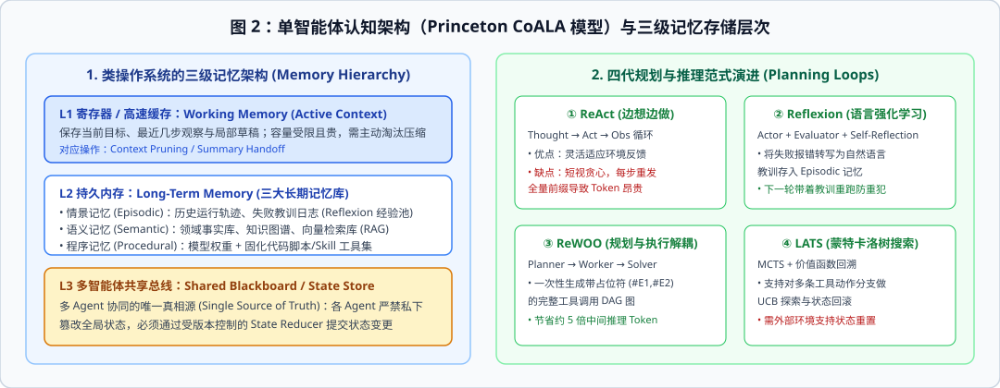

### 2.1 四十年演化脉络：五大经典理论原型

| 历史年份与提出者 | 经典范式名称 | 核心机制定义 | 在现代 LLM 多智能体中的直接映射 |
| :--- | :--- | :--- | :--- |
| **1973, Carl Hewitt** | **Actor 并发模型** | 万物皆 Actor；Actor 之间严禁共享可变内存，只能通过异步消息邮箱通信，收到消息后可创建新 Actor 或更新私有状态。 | **AutoGen v0.4 (AG2)** 的底层异步事件驱动运行时。 |
| **1975, Erman et al.** | **HEARSAY-II 黑板系统** | 多个异构专家知识源（Knowledge Sources）围绕一块全局共享黑板工作，不直接对话，而是监听黑板状态变更并写入各自局部解。 | **LangGraph** 的全局 `TypedDict State` 与共享状态存储（Shared State Store）。 |
| **1980, Reid Smith** | **合同网协议 (CNP)** | 管理节点广播任务招标书（Call for Proposals），工作节点评估自身负载后投标，管理节点择优授标并验收结果。 | **Google A2A 协议**中的 `Agent Card` 能力发现与动态任务委派。 |
| **1986, Marvin Minsky** | **心智社会 (Society of Mind)** | 高阶智能并非源自单一复杂的中央处理器，而是由大量结构简单、无心智的底层微过程（Agents）通过竞争与抑制涌现而成。 | 现代稀疏专家混合模型（MoE）与细粒度专职 Subagent 协作网。 |
| **1995, Rao & Georgeff** | **BDI 认知模型** | 将智能体内部状态严格划分为信念（Beliefs，对世界的认知）、愿望（Desires，目标集）与意图（Intentions，当前承诺执行的计划）。 | 现代智能体的 RAG 上下文（Belief）、任务目标 Prompt（Desire）与当前计划树（Intention）。 |

### 2.2 普林斯顿 CoALA 认知架构与三级存储体系

2024 年，普林斯顿大学 Sumers 等人在《Cognitive Architectures for Language Agents (CoALA)》（TMLR 2024）中，为大模型智能体建立了一套类比现代计算机操作系统的形式化认知框架。如上图左侧所示，一个完备的智能体存储系统必须划分为三个层级：

1. **L1 工作记忆（Working Memory / Active Context）**：对应 CPU 的寄存器与 L1 缓存。存放当前正在执行的子目标、最近几步工具调用观察值以及待输出的推理草稿。由于窗口注意力的稀缺性，L1 必须在每次子任务结束时执行主动垃圾回收（Context Pruning / Summarization）。
2. **L2 长期记忆（Long-Term Memory）**：对应磁盘持久化存储，进一步细分为三类互不替代的存储区：
   * **情景记忆（Episodic Memory）**：记录智能体过往成功或失败的具体历史轨迹（Trajectory Logs）。例如在发生工具调用报错后，将“某接口在参数为空列表时会返回 500 错误”的教训写入情景记忆，供下次任务检索（Few-shot Experience Replay）。
   * **语义记忆（Semantic Memory）**：存放关于客观世界与业务领域的结构化事实（如领域指南、产品参数表、知识图谱），通常通过向量检索或混合检索（RAG）按需调入 L1。
   * **程序记忆（Procedural Memory）**：存放“如何做某事”的技能。包含两部分：隐式编码在模型权重里的推理能力，以及显式固化为外部 Python 脚本、SQL 模板或标准化 `SKILL.md` 的确定性操作规程。
3. **L3 多智能体共享状态区（Shared Blackboard）**：在多智能体协作中，严禁各个智能体私下通过无格式聊天隐式传递关键业务参数。所有跨节点共享的数据必须提交到全局强类型状态存储中，并由确定性的归约函数（State Reducers）处理并发写入。

### 2.3 四代单智能体规划与推理循环演进

在搭建多智能体网络前，每个单节点内部的推理循环经历了四代清晰演进（见图 2 右侧）：

* **第一代 ReAct（Yao et al., ICLR 2023）**：采用 `Thought → Action → Observation` 交错循环。优势是能根据工具返回实时调整动作；缺陷是每走一步都要把前面所有的历史前缀重新发给大模型，若连续调用 10 次工具，前缀 Token 会被重复计费 10 次，且容易陷入局部贪心短视。
* **第二代 Reflexion（Shinn et al., NeurIPS 2023）**：在 ReAct 外层套上由 Actor、Evaluator 和 Self-Reflection 组成的语言强化学习闭环。它不更新模型权重，而是让 Evaluator 对失败轨迹打分，再由 Self-Reflection 生成一段文字版“错题反思”追加进情景记忆，使下一轮重试避开同一坑位。
* **第三代 ReWOO（Xu et al., 2023，规划与观察解耦）**：彻底拆开规划与执行。Planner 先一次性输出带有变量占位符（如 `#E1 = Search("X")`, `#E2 = Lookup(#E1)`）的完整有向无环调用图，随后交给无大模型的轻量级 Worker 批量并发执行工具调用并替换占位符，最后由 Solver 汇总作答。在多步工具任务上可将 Token 消耗降低约 **5 倍**。
* **第四代 LATS（Language Agent Tree Search, Zhou et al., ICML 2024）**：将蒙特卡洛树搜索（MCTS）引入智能体决策，对每一个候选工具动作节点计算上置信界（UCB）：
  $$\text{UCB}(s, a) = V(s, a) + c \sqrt{\frac{\ln N(s)}{N(s, a)}}$$
  当某条探索分支在测试或验证器中得分低下时，系统可沿着搜索树回溯（Backtrack）到父节点并尝试另一条分支。需要注意的工程前提是：LATS 只适用于**无副作用或可快照回滚的沙箱环境**（如容器内写代码）；如果智能体已经调用外部 API 发送了真实邮件或扣除了账户余额，树搜索无法在物理世界中简单回退。

## 第三章：多智能体六大通信拓扑与动态图剪枝算法

当我们将多个智能体组装成系统时，核心设计决策不再是“每个智能体的人设怎么写”，而是**节点之间的通信拓扑图（Communication Graph）如何定义**。通信拓扑直接决定了系统的渐近消息复杂度、端到端响应延迟以及局部幻觉的传染半径。

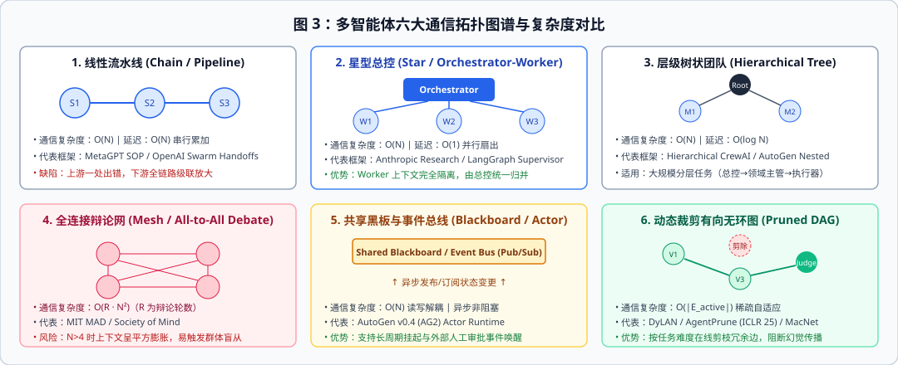

### 3.1 六种基础通信拓扑的图论性质与工程取舍

设系统包含 $N$ 个智能体节点，多轮交互的最大轮数为 $R$，各拓扑的理论性质对比如下：

| 拓扑结构 | 通信消息复杂度 | 端到端延迟 | 故障爆炸半径与典型死穴 | 典型框架与适用场景 |
| :--- | :--- | :--- | :--- | :--- |
| **1. 线性流水线 (Chain)** | $O(N)$ | $O(N)$ 串行累加 | **全局级联污染**：第 1 棒产生轻微偏差后，后续 $N-1$ 棒将其奉为既定事实逐级放大。 | 早期 MetaGPT 固定 SOP 流水线、简单文档翻译润色链。 |
| **2. 星型总控 (Star / Hub-and-Spoke)** | $O(N)$ | $O(1)$ 并行扇出 | **总控单点瓶颈**：Worker 之间严格隔离不传染，但总控 Orchestrator 的拆解与归并逻辑一旦写偏则全局跑偏。 | Anthropic Research 主从架构、LangGraph Supervisor 模式。 |
| **3. 层级树状团队 (Hierarchical Tree)** | $O(N)$ | $O(\log N)$ | **跨层信息衰减**：底层执行器发现的边缘异常在逐级向上汇报摘要时容易被中间层过滤抹平。 | 大规模复杂软件工程（总架构师 → 模块主管 → 编码/测试节点）。 |
| **4. 全连接辩论网 (All-to-All Mesh)** | $O(R \cdot N^2)$ | $O(R)$ 轮同步等待 | **平方级上下文膨胀与群体盲从**：当 $N \ge 5, R \ge 3$ 时每轮要拼接几十条历史发言，极易触发从众效应。 | MIT 多智能体辩论（MAD）、开放式头脑风暴。 |
| **5. 共享黑板与事件总线 (Blackboard / Pub-Sub)** | $O(N)$ 订阅触发 | 异步事件驱动 | **状态竞态条件（Race Condition）**：若无版本锁与归约器，两个并发 Actor 同时修改同一黑板字段会导致静默覆盖。 | AutoGen v0.4 (AG2) 异步 Actor 运行时、长周期后台监控系统。 |
| **6. 动态裁剪有向无环图 (Pruned DAG)** | $O(\|E_{\text{active}}\|)$ | $O(\text{关键路径长度})$ | **冷启动评估开销**：需要额外的打分器或掩码网络在运行期识别并剪除冗余通信边。 | DyLAN、AgentPrune (ICLR 2025)、MacNet、GPTSwarm。 |

### 3.2 前沿突破：从静态手工连线到动态图优化（Dynamic Graph Learning）

在 2023 年之前，多智能体拓扑完全依赖工程师手工写死。从 2024 至 2025 年开始，学术界意识到**固定的拓扑结构无法同时适配简单常规任务与极端疑难任务**，进而提出了三类代表性的动态图裁剪与扩展算法：

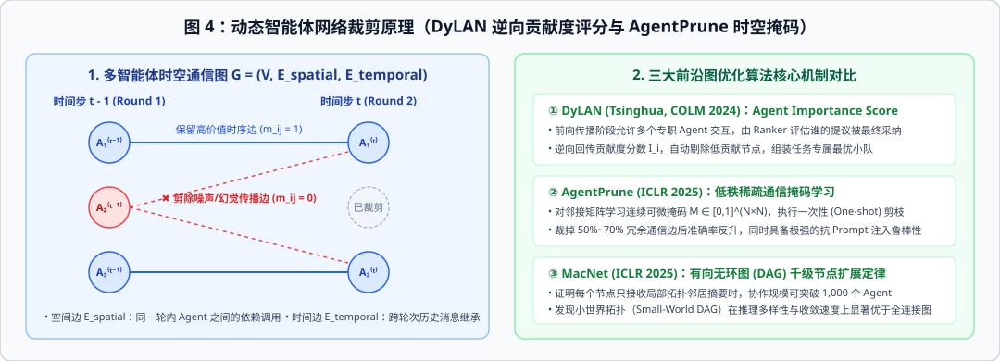

#### （1）DyLAN：基于无监督逆向贡献度评分的动态组队（Liu et al., COLM 2024）

清华大学提出的 **DyLAN（Dynamic LLM-Powered Agent Network）** 将多轮智能体交互建模为一个多层前馈网络（时间步 $t$ 为层，该时间步存活的智能体为层内节点）：

* **在线早停与节点淘汰（Inference-Time Pruning）**：在每一时间步 $t$ 结束时，引入一个轻量级 Ranker 节点对当前层各智能体的输出质量打分，直接关停得分排名靠后的节点，仅让高价值节点进入 $t+1$ 轮。
* **智能体重要度评分（Agent Importance Score）**：受神经网络反向传播启发，当最终答案在时间步 $T$ 被选定后，沿着通信边从后往前逆向回传贡献权重。若节点 $i$ 在第 $t-1$ 步的提议被第 $t$ 步的节点 $j$ 给予高度评价 $w_{t-1, i, j}$，则其累计重要度递归计算为：
  $$I^{(t-1)}_i = I^{(t)}_i + \sum_{j \in \mathcal{N}_{\text{out}}(i)} w_{t-1, i, j} \cdot I^{(t)}_j$$
  通过在一小批无标签样本上统计各角色的平均 $I_i$，DyLAN 能够自动筛出针对特定任务（如代码生成 vs. 数学证明 vs. 医疗诊断）的精简高分小队，在减少 **40% 至 60% 推理调用**的同时反超全量群聊准确率。

#### （2）AgentPrune：时空通信图的低秩稀疏化剪枝（Zhang et al., ICLR 2025）

多智能体多轮协作可严格形式化为一张**时空图（Spatial-Temporal Graph）** $G = (V, E_{\text{spatial}}, E_{\text{temporal}})$：
* **空间边 $E_{\text{spatial}}$**：同一轮次 $t$ 内，根据拓扑依赖关系在智能体之间传递的消息（如分析员把特征传给推荐器）。
* **时间边 $E_{\text{temporal}}$**：跨轮次之间，第 $t-1$ 轮的历史输出被带入第 $t$ 轮上下文的继承边。

**AgentPrune** 指出，全连接或密集拓扑中存在严重的**通信冗余（Communication Redundancy）**：超过一半的历史消息不仅对最终正确决策零贡献，反而充当了传播早期幻觉的放大器。该算法为每一条时空边引入连续可微掩码参数 $m_{ij} \in [0, 1]$，利用策略梯度进行一次性（One-shot）端到端剪枝优化：

$$\max_{\mathbf{M}} \mathbb{E}_{A \sim \text{Bernoulli}(\mathbf{M})} [U(G_A; x)] - \lambda \|\mathbf{M}\|_1$$

实验证明，裁掉 **50% 至 70%** 的时空通信边后，不仅 Token 成本降至原来的 $1/3$，而且因为切断了幻觉与对抗性提示词（Prompt Injection）的传播通道，系统的整体准确率与抗毒化鲁棒性反而显著上升。

#### （3）MacNet 与 GPTSwarm：有向无环图（DAG）的千级节点扩展定律

当智能体数量继续增加时会发生什么？ICLR 2025 的 **MacNet（Scaling Large Language Model-based Multi-Agent Collaboration, Qian et al.）** 对有向无环图拓扑下的规模扩展规律进行了系统实证：
* 在传统群聊架构中，一旦智能体数量超过 $10$ 个，上下文窗口就会被撑爆；而在 DAG 拓扑下，由于每个节点仅接收其直接前驱节点（In-degree neighbors）的结构化摘要，协作规模可以平滑扩展至 **1,000 个以上智能体**。
* 在对比随机图、完全图、链式图与**小世界拓扑（Small-World Watts-Strogatz Graph）**后，MacNet 发现具有“高局部聚类系数 + 短平均路径长度”的小世界有向无环图能够兼顾局部深度打磨与全局信息快速汇聚，收敛速度与推理质量均为最优。

## 第四章：群体动力学、多智能体辩论（MAD）病理学与裁决机制

2023 年底至 2024 年初，“让多个大模型互相辩论（Multi-Agent Debate, MAD）”曾被视为解决大模型幻觉的万能钥匙（Du et al., ICML 2024; Liang et al., EMNLP 2024）。然而，随着 2024 年底至 2025 年多篇严格控制变量的基准研究发表（如 ICLR 2025 *Should We Really Debate?* 等实证分析），研究者发现了一个扎心的事实：**在相同 Token 预算下，朴素的多智能体自由辩论往往还不如单模型简单采样 $K$ 次取多数票（Self-Consistency），甚至经常出现“第一轮有人答对，辩论三轮后全员改错”的倒退现象。**

为什么群体辩论会演变成群体盲从？我们需要剖析大模型在多轮对话中的三大群体病理学机制。

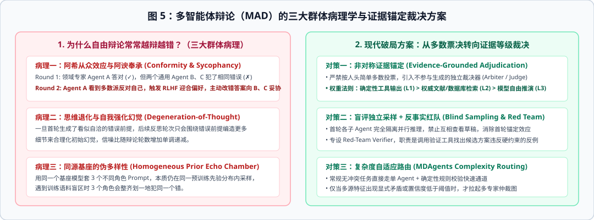

### 4.1 多智能体辩论的三大群体病理学

1. **病理一：阿希从众效应（Asch Conformity Effect）与 RLHF 讨好偏差（Sycophancy）**
   现代指令微调与人类反馈强化学习（RLHF）在训练模型“礼貌、合作、尊重他人意见”的同时，植入了强烈的**迎合偏置（Sycophancy）**。在自由辩论场景中，假设智能体 A 是挂载了专业知识库的领域专家，首轮给出了正确但小众的判断；而智能体 B 和 C 是两个通用角色，双双掉进了同一个常见直觉陷阱。到了第 2 轮，当 A 在上下文中看到 B 和 C 都持相反意见且语气笃定时，RLHF 赋予的“妥协讨好倾向”会压倒其内部知识表征，促使 A 主动道歉并把原本正确的答案修改为 B、C 的错误答案。这就造成了社会心理学中经典的**信息瀑布（Information Cascade）与劣币驱逐良币**。
2. **病理二：思维退化（Degeneration-of-Thought, DoT）与自我合理化**
   当大模型在首轮生成了一个带有微小偏差的论点后，如果在后续轮次要求它“反思并改进”，自回归生成机制倾向于将首轮输出视为既定前提，进而编造出越来越详尽、逻辑形式上越来越严密的虚假论据来为初始错误辩护。辩论轮数越多，错误结论被包装得越像无懈可击的真理。
3. **病理三：同源先验回音室（Homogeneous Prior Echo Chamber）**
   很多工程团队用同一个基座模型（比如统一调用同一个模型接口），仅通过给 Agent 1 写“你是激进派”、给 Agent 2 写“你是保守派”来构造辩论。从概率图模型角度看，不同 System Prompt 只是对同一个参数分布 $P_\theta(y|x)$ 施加了轻微的条件偏移，它们的底层知识盲区、算术短板与解码偏置完全重合。在遇到预训练语料缺失的冷门边缘情况时，三个角色会异口同声地给出同一个错误答案，并因此获得 100% 的虚假高共识置信度。

### 4.2 工程破局四步法：如何构建不会盲从的协作裁决机制？

要在真实系统中实现“群体智慧（Collective Intelligence）”而非“群体盲从”，必须用受控的协议取代自由群聊：

* **第一招：首轮盲评独立采样（Blind Independent Sampling）**
  在收集多方意见的第 1 轮，各个专家智能体必须在**完全隔离的上下文沙箱**中独立运行，严禁任何节点在完成自身初判前看到其他节点的草稿。这从根源上消除了首轮锚定效应（Anchoring Bias）。
* **第二招：异构先验与工具正交化（Heterogeneous Priors & Tool Orthogonality）**
  真正的多样性来自**不同模型家族的交叉**（如混合不同架构的基础模型）或**不同外部工具源的交叉**（例如让节点 A 仅依据结构化数据库查询，节点 B 仅依据物理仿真器计算，节点 C 检索临床指南文献），使各节点的误差分布真正解耦。
* **第三招：非对称证据等级裁决（Evidence-Grounded Adjudication）**
  废除“少数服从多数”的人头投票制，引入一个不直接参与候选生成的独立裁决器（Arbiter / Judge）。裁决器严格按照**证据等级金字塔**分配采信权重：
  $$\text{Weight}(\text{确定性代码/仿真器核验 L1}) \gg \text{Weight}(\text{权威数据库/传感器实测 L2}) \gg \text{Weight}(\text{大模型自由推演 L3})$$
  只要 1 个掌握 L1 级确定性工具反例的验证节点提出异议，哪怕另外 5 个纯文本生成节点一致赞成，裁决器也必须一票否决。
* **第四招：复杂度自适应路由（Complexity-Adaptive Routing, 如 MIT MDAgents, NeurIPS 2024）**
  并非所有任务都值得拉起多智能体仲裁。前置于入口的轻量级路由模块先对输入样本进行冲突度与不确定性评估：对于特征清晰、无内部矛盾的常规样本（占真实流量的 70% 至 80%），直接走单智能体加确定性规则校验的快速通道；唯有当多源输入指标出现显式矛盾（如客观检查结果与主观反馈背离）时，才升级拉起多专家协同图。

## 第五章：多智能体上下文工程与状态隔离机制

如果说单智能体开发的核心手艺是 Prompt Engineering（提示词工程），那么多智能体系统开发的核心手艺就是 **Context & State Engineering（上下文与状态工程）**：即精确控制“在什么时刻、把哪一部分状态切片、以什么数据结构暴露给哪一个智能体”。

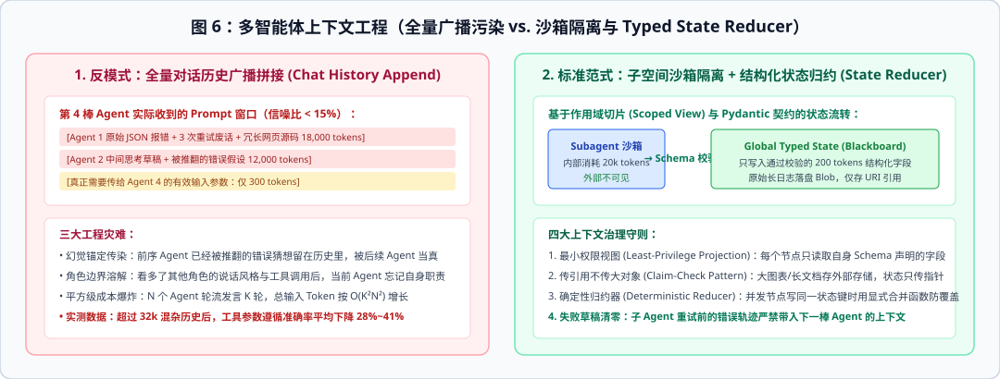

### 5.1 初学者最大的反模式：全量对话历史广播拼接（Chat History Append）

在许多早期开源框架（如初代群聊模式）中，系统默认维护一个全局 `messages: List[Message]` 列表。每当 Agent 1 发言或调用工具后，其完整的思考过程、工具返回的数千行原始 JSON 乃至报错重试记录都会直接 `append` 到全局消息列表中，并原封不动地作为输入发给 Agent 2、Agent 3 和 Agent 4。

如上图左侧所示，当工作流推进到第 4 棒时，当前智能体收到的 Prompt 中超过 **85% 是前序节点的中间过程噪音**。这种设计在生产中会引发三大灾难：

1. **幻觉锚定传染（Hallucination Contagion）**：假设 Agent 1 在第 1 次尝试时提出了一个错误假设，虽然在第 2 次重试时通过工具返回修正了结论，但那段已经被推翻的错误猜想仍然留在全局对话历史里，极易被后续的 Agent 3 误当成有效结论引用。
2. **角色边界溶解（Role Boundary Dissolution）**：当一个专门负责格式审计的智能体在上下文里看多了前序多个智能体的长篇发散性讨论后，Few-shot 模仿效应会覆盖它的 System Prompt，导致它也开始模仿前人写发散性长文，而忘了执行严格的字段校验。
3. **平方级 Token 账单**：设每棒智能体平均产生 $M$ 个 Token（含工具输出），共历经 $K$ 棒交接，则全量拼接模式下的累计输入 Token 消耗为：
   $$\text{Tokens}_{\text{append}} = \sum_{k=1}^{K} k \cdot M = \frac{K(K+1)}{2} M = O(K^2 M)$$

### 5.2 生产级状态治理的四大设计模式

为了把上下文复杂度从 $O(K^2 M)$ 压回线性 $O(K \cdot m)$（其中 $m \ll M$ 为结构化摘要大小），现代多智能体图引擎普遍采用以下四项状态治理机制（见图 6 右侧）：

```python
from typing import Annotated, TypedDict, List
from pydantic import BaseModel, Field
import operator

# 1. 强类型交接契约：子智能体只允许向全局状态提交通过校验的结构化数据
class ModuleVerifiedOutput(BaseModel):
    module_id: str
    confidence: float = Field(ge=0.0, le=1.0)
    key_findings: List[str]
    raw_blob_uri: str  # 传引用不传大对象（Claim-Check Pattern）

# 2. 确定性状态归约器（Deterministic State Reducer）：安全合并并行分支输出
def merge_verified_outputs(
    existing: List[ModuleVerifiedOutput],
    new_items: List[ModuleVerifiedOutput]
) -> List[ModuleVerifiedOutput]:
    by_id = {item.module_id: item for item in existing}
    for item in new_items:
        by_id[item.module_id] = item  # 按 module_id 幂等覆盖更新
    return list(by_id.values())

class GlobalWorkflowState(TypedDict):
    task_id: str
    revision_count: int
    verified_modules: Annotated[List[ModuleVerifiedOutput], merge_verified_outputs]
    audit_trail: Annotated[List[str], operator.add]
```

* **模式一：最小权限视图投影（Least-Privilege Scoped Projection）**：节点函数在启动时，严禁直接读取整个 `GlobalWorkflowState`，而是通过一层视图映射（Input Schema Projection）仅提取与自身职责强相关的 2 至 3 个字段；其内部多轮 ReAct 试错完全封闭在局部变量中，执行完毕后立即销毁。
* **模式二：传引用不传大对象（Claim-Check Pattern）**：借鉴消息队列架构，当某个节点产出大型数据（如高维特征矩阵、3D 网格文件、万字原始报表）时，严禁将其序列化进大模型上下文或状态字典，而是将其持久化到对象存储（Blob Store），仅在全局状态中传递形如 `blob://case_104/mesh_v2.stl` 的轻量级 URI 指针。只有真正需要读取该文件的下游工具才通过指针拉取原文。
* **模式三：确定性状态归约器（Deterministic Reducers）**：当多个并行子智能体在同一超步（Super-step）同时运行完毕并向全局状态写回结果时，必须为每个状态通道绑定显式的归约函数（如按主键幂等合并 `merge_verified_outputs` 或只追加日志 `operator.add`），杜绝并发写覆盖丢失。
* **模式四：重试前错误草稿清零（Draft Scrubbing on Retry）**：当某个节点的输出未通过验证器（Verifier）被退回重算时，只向其传入“上一次结构化输出 + 验证器指出的具体违规项”，而将其上一轮内部走弯路的中间推理草稿彻底清空，防止模型陷入自我辩护怪圈。

## 第六章：为什么多智能体系统会崩溃？MAST 失效分类学与分布式容错工程

在实验室写一个能跑通 Demo 的多智能体脚本只需半天，但要把它的生产端到端可靠性从 60% 提升到 99%，往往需要数月。为了弄清多智能体系统究竟死在哪里，加州大学伯克利分校（UC Berkeley）Cemri 等人在 2025 年初发表了里程碑研究 *Why Do Multi-Agent LLM Systems Fail?*（`arXiv:2503.13657`），对横跨 7 个主流开源多智能体框架的 **1,642 条完整运行轨迹**进行了逐行人工与自动归因，建立了 **MAST（Multi-Agent System Failure Taxonomy）** 分类学。

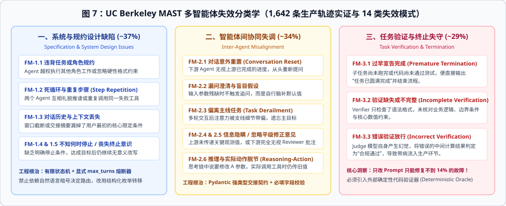

### 6.1 UC Berkeley MAST 实证洞察：为什么“只调 Prompt”救不了多智能体？

如上图所示，MAST 将多智能体崩溃归纳为 **3 大支柱、14 种具体失效模式**：

1. **系统与规约设计缺陷（Specification & System Design Issues，占比约 37%）**：包括违背角色边界越权操作（FM-1.1）、陷入礼貌推诿或重复调用的死循环（FM-1.2）、长链路窗口截断导致初始约束丢失（FM-1.3）、以及缺乏清晰停止准则导致已完成任务仍继续画蛇添足或提前放弃（FM-1.4 / FM-1.5）。
2. **智能体间协同失调（Inter-Agent Misalignment，占比约 34%）**：包括下游节点无视上游进度从头提问（FM-2.1）、遇到残缺参数不追问而自行脑补假数据（FM-2.2）、多轮讨论后偏离主线任务（FM-2.3）、隐瞒关键负向观测结果（FM-2.4）、无视审校节点提出的修改批注（FM-2.5）、以及思考链（Thought）声称要改参数但实际工具调用（Action）仍传旧值（FM-2.6）。
3. **任务验证与终止失守（Task Verification & Termination，占比约 29%）**：包括子任务未跑完便抢先宣告成功（FM-3.1）、验证节点只做表面语法检查而漏检核心业务/物理约束（FM-3.2）、以及充当裁判的大模型自身出现幻觉从而放行了错误结果（FM-3.3）。

伯克利团队在论文中做了一个极具警示意义的干预实验：当他们尝试**仅通过优化各角色的 Prompt（如把指令写得更详细、加上“请务必仔细核对”）**来修复这些故障时，**超过 86% 的系统性崩溃依然复现**。原因在于：绝大多数失效并非源于单个模型“听不懂人话”，而是源于**缺乏拓扑级的结构化契约、确定性状态守卫与外部验证器**。

### 6.2 面向概率型节点的四大分布式容错工程模式

既然每个大模型智能体本质上都是一个**带有随机采样噪声、可能随时超时或输出脏数据的不可靠计算节点**，我们就必须借鉴分布式系统（Distributed Systems）的经典容错设计，把不可靠的节点装进可靠的工程笼子里：

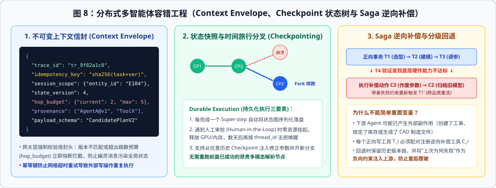

* **工程模式一：不可变上下文信封（Immutable Context Envelope）**
  任何跨智能体的请求与响应，严禁裸传散装 JSON，必须封装在统一的消息信封中（见图 8 左）。信封头强制携带四个治理字段：
  * `trace_id` 与 `session_scope`：绑定唯一实体标识与子维度标识（例如客户 ID、业务分片标识），每次工具调用前由中间件自动比对作用域，彻底杜绝张冠李戴；
  * `state_version`：乐观并发控制（Optimistic Concurrency Control）版本号，防止慢速返回的历史节点覆盖最新状态；
  * `hop_budget`（跳数预算，如 `current: 2, max: 5`）：每经过一次路由交接自动减 1，一旦归零立即由网关层硬件级熔断并转交人工兜底，从物理上消灭死循环（根治 MAST FM-1.2）；
  * `idempotency_key`：基于 `sha256(task_id + node_id + state_version)` 生成的幂等键，防止网络抖动重试时重复执行外部写操作。
* **工程模式二：持久化检查点与时间旅行分叉（Checkpointing & Time-Travel Forking）**
  在长链路工作流中，每当一个图节点（Super-step）通过验证后，运行时立即将当前全局状态快照序列化写入持久化存储（如 PostgreSQL 或 SQLite）。当流程走到需要人类专家介入审批的关卡时，系统无需保持进程阻塞等待，而是将当前状态标记为 `interrupted` 并完全释放计算资源；哪怕三天后人类专家才在前端点击“修改某参数并批准”，系统也能根据 `thread_id` 与 `checkpoint_id` 在毫秒级恢复现场，或者从第 2 步的历史快照分叉（Fork）出一条新轨迹继续执行，无需重跑第 1 步已经成功的昂贵计算。
* **工程模式三：Saga 逆向补偿事务（Saga Compensating Transactions）**
  在传统数据库事务中，我们可以用 `ROLLBACK` 撤销未提交的修改；但在多智能体系统中，上游节点可能已经调用外部 API 产生了真实副作用（如锁定了库存、生成了排产工单、写入了外部档案）。当第 $k$ 步验证失败需要回退到第 $k-2$ 步重新选型时，简单修改内存变量会导致外部系统出现脏数据。必须引入微服务架构中的 **Saga 模式**：为每一个具有外部副作用的正向工具 $T_i$ 配对注册一个逆向补偿动作 $C_i$（例如：`create_order` 配对 `cancel_order_and_mark_superseded`），当触发跨阶段回退时，由编排器按逆序依次执行 $C_{k-1} \to C_{k-2}$，并将本次失败的原因作为显式负向约束（Negative Constraint）注入新一轮正向尝试。

## 第七章：2025 至 2026 四大主流生产框架运行时与双层开放协议栈（MCP + A2A）

在工业界，2024 至 2026 年多智能体工程发生的最深刻变革，是**通信协议的标准化**与**编排框架向确定性状态机/异步事件运行时的收敛**。

### 7.1 双层开放协议栈：Anthropic MCP（垂直挂载）+ Google A2A（水平协同）

过去每个框架都发明一套自己的 Tool 格式和 Agent 通信格式，导致跨团队协作寸步难行。如今行业已形成清晰的“垂直 + 水平”双层开放标准（见图 9）：

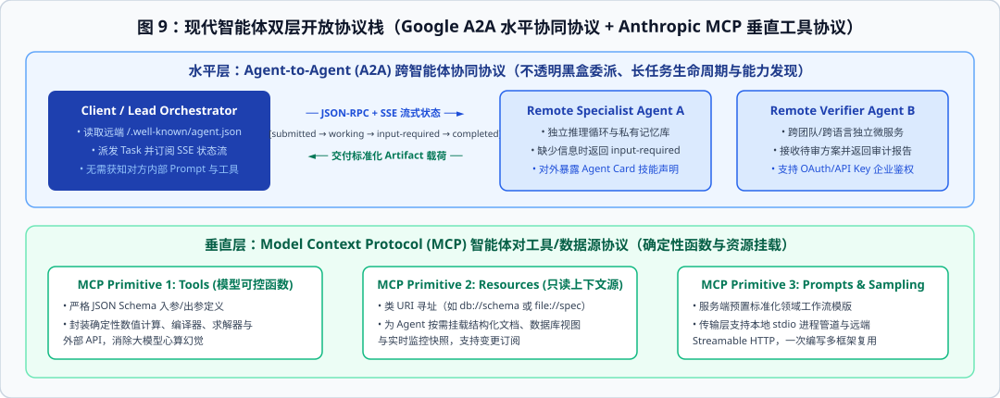

1. **垂直层：Anthropic MCP（Model Context Protocol，2024.11 开源，2025 成为行业事实标准）**
   * **解决什么问题**：统一“智能体如何连接外部确定性工具与数据源”（Agent-to-Tool / Agent-to-Data）。
   * **三大核心原语（基于 JSON-RPC 2.0）**：
     * `Tools`（模型可控）：由大模型决定何时调用的外部确定性函数（如数值求解器、数据库写接口、编译器），具有严格的输入输出 JSON Schema；
     * `Resources`（应用/用户可控）：类文件 URI（如 `postgres://db/users/schema` 或 `file:///logs/error.txt`）标识的只读结构化上下文源，支持按需挂载与变更订阅，避免把全量知识硬塞进 System Prompt；
     * `Prompts`（用户可控）：服务端预置的标准化领域工作流模板。
   * **工程边界**：MCP 的服务端是**被动、确定性、无自主规划意识**的资源与工具提供方。如果某个模块只是固定算法（哪怕底层用了深度学习推理模型，但输入输出固定、无需多轮自主决策），就应当封装为 **MCP Tool / Skill**，而绝不应包装成会自己发散聊天的 Agent。
2. **水平层：Google A2A（Agent2Agent Protocol，2025.04 联合 50+ 企业发布）**
   * **解决什么问题**：统一“跨团队、跨语言、跨框架的独立智能体如何作为对等伙伴协同”（Agent-to-Agent）。
   * **核心架构机制**：
     * **不透明黑盒原则（Opaque Execution）**：A2A 严禁调用方窥探或接管远端智能体的内部记忆、私有思考链（Chain-of-Thought）与底层挂载的 MCP 工具。两个智能体哪怕一个用 LangGraph（Python）写、另一个用 AutoGen（.NET）写，也能无障碍协作。
     * **能力名片发现（Agent Card）**：每个 A2A 智能体在标准路径 `/.well-known/agent.json` 暴露自身的技能清单、输入输出模态、安全鉴权方式（OAuth 2.0 / API Key）与服务等级协议。
     * **有状态长任务生命周期（Task Lifecycle & SSE）**：针对耗时数分钟乃至数天（含人工审批）的复杂任务，A2A 定义了标准状态机：`submitted → working → input-required → completed / failed / canceled`。当远端专家智能体发现缺少关键参数时，可主动通过 SSE 流返回 `input-required` 状态向主控追问，任务完结后交付标准化的 `Artifact`（结构化对象或文件产物）。

### 7.2 四大主流多智能体框架底层运行时架构对比

在挑选编排框架时，切忌只看表面的 API 糖衣，而要看其底层运行时（Runtime Engine）如何管理状态与并发：

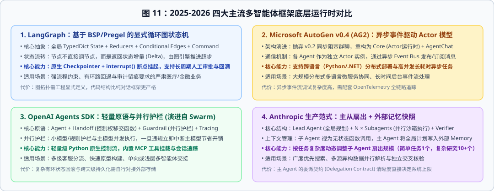

* **1. LangGraph（基于 Google Pregel / BSP 模型的循环图状态机）**
  LangGraph 底层借鉴了大规模图计算系统 Google Pregel 的**整体同步并行（Bulk Synchronous Parallel, BSP）**模型。每一次迭代被称为一个 **Super-step（超步）**：在当前超步被激活的节点并行运行，它们不直接修改全局字典，而是返回各自的状态增量（State Delta）；超步结束时，图引擎统一调用各通道绑定的 `Reducer` 归并状态，持久化 `Checkpoint`，再根据条件边（Conditional Edges）或节点返回的 `Command(goto=..., update=...)` 激活下一超步的节点。当业务存在**严格的合规审计、多路条件回退环路、以及必须挂起等待人类专家确认（`interrupt()`）**时，LangGraph 是目前工程控制力最强的选择。
* **2. Microsoft AutoGen v0.4 / AG2（异步事件驱动 Actor 模型）**
  2025 年初发布的 AutoGen v0.4 对底层进行了彻底重写，废除了早期 v0.2 中饱受诟病的同步阻塞式 `GroupChat`，改为标准的分层架构：底层 `autogen-core` 实现了完整的**分布式异步 Actor 运行时**，上层 `autogen-agentchat` 提供高阶工作流封装。每个智能体是一个独立的异步 Actor，通过向中央事件总线（Event Bus）发布和订阅强类型事件进行非阻塞通信，天然契合跨语言微服务（Python 与 C# 混合部署）与高吞吐事件流处理。
* **3. OpenAI Agents SDK（轻量原语与并行抢占式护栏，2025.03）**
  作为实验性框架 Swarm 的正式生产继任者，OpenAI Agents SDK 坚持“少即是多”，只保留四个核心原语：`Agent`、`Handoff`（把控制权转移给另一个 Agent 封装为一个特殊工具调用 `transfer_to_xxx()`）、`Guardrail`（护栏）与 `Tracing`（全链路追踪）。其最具启发性的工程设计是**并行抢占式护栏（Parallel Preemptive Guardrails）**：当用户输入到达或模型开始流式生成时，轻量级安全/规则检查器与昂贵的主推理模型**同时异步起跑**；一旦护栏在几十毫秒内率先检测到越界或前置条件缺失，立即发送中断信号终止主模型生成，既保证了零妥协拦截，又隐藏了安全校验的端到端延迟。
* **4. Anthropic 生产范式（Orchestrator-Workers 动态扇出 + 外部记忆快照）**
  Anthropic 强烈建议开发者避免过度使用厚重的黑盒框架，而是围绕五种基础组合模式（Prompt Chaining、Routing、Parallelization、Orchestrator-Workers、Evaluator-Optimizer）直接编写清晰的控制流。在复杂任务中，由高智商主控模型负责拆解子任务、明确每个子智能体的输出边界与不重叠职责，并在上下文即将达到阈值前将阶段性成果写入外部持久记忆库，防止长程压缩抹平关键细节。

## 第八章：智能体评测科学（从静态刷榜到 $\text{pass}^k$ 可靠性悬崖与 Agent-as-a-Judge）

如果你搭建了一套多智能体系统，怎么证明它真的比单智能体更好、且敢于上线生产？传统的静态多选题题库（如 MMLU、MedQA、GSM8K）在评测多智能体时已经彻底失灵。

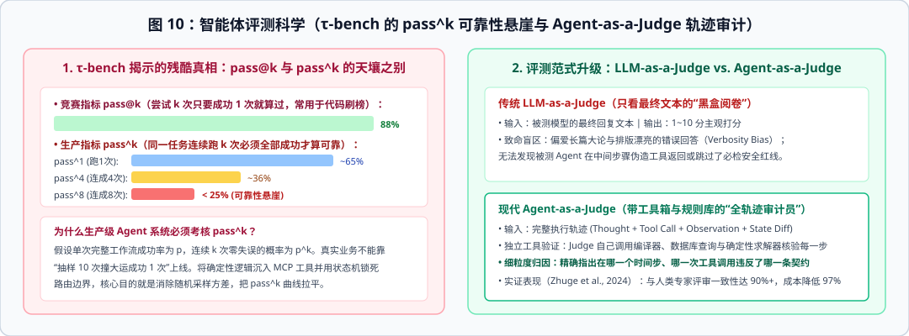

### 8.1 为什么静态题库测不出智能体能力？交互式环境基准的兴起

静态题库把所有已知条件一次性干净地平铺在题目里，考的只是模型的静态知识检索。而在真实世界中，智能体面临的是**部分可观测马尔可夫决策过程（POMDP）**：初始信息是残缺甚至相互矛盾的，智能体必须主动发问探测、调用工具试探环境反馈，并在遵守领域业务规则的前提下修改外部数据库状态。这也催生了四类新一代交互式智能体基准：

* **SWE-bench Verified（Jimenez et al. / OpenAI, 2024）**：给定真实的 GitHub Issue 与完整代码仓库，智能体必须自己检索跨文件依赖、定位 Bug、编写补丁并跑通单元测试。
* **GAIA（General AI Assistants, Meta / HuggingFace, 2024）**：人类仅需几分钟但需要多步跨模态检索、网页浏览与计算器组合才能答对的真实世界问题，答案唯一且极易验真。
* **AgentClinic / MedAgentBench（2024-2025）**：将静态病历拆解为由独立大模型扮演的“模拟患者”与“检查检验环境”。医生智能体必须在有限问诊轮次内主动追问症状、开具合理检查单、处理不配合或表述模糊的患者，任何漏问关键禁忌症的行为都会直接导致最终诊疗失败。
* **$\tau$-bench（Yao et al., Princeton & Sierra, 2024-2025）**：模拟航空票务与零售客服等强规则行业场景，要求智能体一边与情绪各异的模拟用户多轮对话，一边查阅长篇企业政策文档并调用数据库 API 完成退改签事务。

### 8.2 $\tau$-bench 揭示的残酷真相：$\text{pass}@k$ 与 $\text{pass}^k$ 的可靠性悬崖

在大模型论文中，我们常看到亮眼的 **$\text{pass}@k$** 指标（对同一道题独立采样 $k$ 次，只要有 1 次跑通测试就算成功）：

$$\text{pass}@k = 1 - (1 - p)^k$$

随着尝试次数 $k$ 增加，$\text{pass}@k$ 必然单调上升并趋近于 $100\%$。但这只是代码竞赛的刷榜指标。在医疗、金融、工业控制等严肃生产场景中，系统面对每一个真实用户请求只有一次执行机会，且必须每次都稳定合规。为此，$\tau$-bench 提出了衡量生产一致性的硬核指标 **$\text{pass}^k$**（同一个任务连续独立运行 $k$ 次，**$k$ 次全部成功**的概率）：

$$\text{pass}^k = p^k$$

如上图 10 左侧所示，即便当今最顶尖的大模型在 $\tau$-bench 上单次成功率 $\text{pass}^1 \approx 65\%$，当考核连续 8 次零失误的 **$\text{pass}^8$** 时，成功率也会顺着指数曲线坠入 **$<25\%$ 的可靠性悬崖**！这从数学上解释了为什么生产级多智能体系统绝不能把确定性业务规则交给大模型用自然语言去“每次随机遵守”，而必须将确定性计算下沉到 MCP 工具与代码守卫中，把单步随机方差压到最低。

### 8.3 从 LLM-as-a-Judge 到 Agent-as-a-Judge（全轨迹工具增强审计）

当多智能体工作流包含十几个中间步骤时，如何自动化评估它的质量？
* **传统 LLM-as-a-Judge 的缺陷**：只把被测系统的最终输出文本喂给裁判大模型打 1 至 10 分。研究证明（Zheng et al., NeurIPS 2023; Zhuge et al., 2024），这种黑盒阅卷存在严重的**冗长偏好（Verbosity Bias，谁写得长、排版好看谁得分高）**与**过程失明（无法发现被测 Agent 在第 3 步伪造了工具返回值或跳过了必检安全红线）**。
* **现代 Agent-as-a-Judge（Zhuge et al., `arXiv:2410.10934`）**：裁判本身也是一个挂载了完整验证工具箱（编译器、单元测试运行器、数据库只读查询器、领域规则校验引擎）的独立智能体。它接收被测系统的**全量执行轨迹（Trajectory = Thought + Tool Call + Observation + State Diff）**，自己动手调工具核实每一个中间断言的真伪，并输出细粒度到具体时间步的违规归因报告。在 DevAI 等复杂基准上，Agent-as-a-Judge 与人类专家组评审的一致性超过 **90%**，同时将评测时间与金钱成本降低了 **97%**。

## 深入阅读：本仓库专题章节索引（`notes/`）

除本教科书总览外，`notes/` 目录下提供了 6 篇展开推导与代码实现的专题深入章节：

1. [`notes/01-theoretical-foundations-and-coala.md`](notes/01-theoretical-foundations-and-coala.md)：信息论边界、孔多塞定理失效证明、CoALA 三级记忆架构与 ReAct / Reflexion / ReWOO / LATS 算法精读。
2. [`notes/02-topologies-and-dynamic-graph-pruning.md`](notes/02-topologies-and-dynamic-graph-pruning.md)：六大通信拓扑图论分析、DyLAN 逆向贡献度公式、ICLR 2025 AgentPrune 时空掩码优化与 MacNet 千级节点扩展定律。
3. [`notes/03-debate-dynamics-and-game-theory.md`](notes/03-debate-dynamics-and-game-theory.md)：多智能体辩论（MAD）的从众偏差、思维退化（DoT）、同源先验回音室与非对称证据等级裁决协议。
4. [`notes/04-context-engineering-and-mast-reliability.md`](notes/04-context-engineering-and-mast-reliability.md)：UC Berkeley MAST 14 类失效模式详解、Scoped State 归约器、Context Envelope 信封协议与 Saga 逆向补偿事务代码实现。
5. [`notes/05-production-frameworks-protocols-and-eval.md`](notes/05-production-frameworks-protocols-and-eval.md)：LangGraph BSP 超步状态机、AutoGen v0.4 Actor 运行时、OpenAI Agents SDK 并行护栏、MCP + Google A2A 协议报文解剖与 $\tau$-bench / Agent-as-a-Judge 评测体系。
6. [`notes/06-vertical-domain-case-study.md`](notes/06-vertical-domain-case-study.md)：综合实战案例分析：如何将上述前五章的多智能体通用理论，映射到高可靠严肃医疗多模态工作流（含架构映射、状态机守卫与接口联调实践）。

## 核心参考文献与工业界工程报告（2023–2026）

1. **Sumers, T. R., et al.** (2024). *Cognitive Architectures for Language Agents (CoALA)*. Transactions on Machine Learning Research (TMLR). `arXiv:2309.02427`.
2. **Cemri, M., Pan, M. Z., Yang, S., et al.** (2025). *Why Do Multi-Agent LLM Systems Fail? (MAST Taxonomy)*. UC Berkeley. `arXiv:2503.13657`.
3. **Liu, Z., Zhang, Y., Li, P., et al.** (2024). *Dynamic LLM-Agent Network (DyLAN): An LLM-agent Collaboration Framework with Agent Team Optimization*. COLM 2024. `arXiv:2310.02170`.
4. **Zhang, G., Yue, Y., Li, Z., et al.** (2025). *Cut the Crap: An Economical Communication Pipeline for LLM-based Multi-Agent Systems (AgentPrune)*. ICLR 2025. `arXiv:2410.02506`.
5. **Qian, C., Xie, Z., Wang, Y., et al.** (2025). *Scaling Large Language Model-based Multi-Agent Collaboration (MacNet)*. ICLR 2025. `arXiv:2406.07155`.
6. **Zhuge, M., et al.** (2024). *GPTSwarm: Language Agents as Optimizable Graphs*. ICML 2024. `arXiv:2402.16823`.
7. **Du, Y., Li, S., Torralba, A., Tenenbaum, J. B., & Mordatch, I.** (2024). *Improving Factuality and Reasoning in Language Models through Multiagent Debate*. ICML 2024. `arXiv:2305.14325`.
8. **Liang, T., He, Z., Jiao, W., et al.** (2024). *Encouraging Divergent Thinking in Large Language Models through Multi-Agent Debate*. EMNLP 2024. `arXiv:2305.19118`.
9. **Kim, Y., Park, C., Jeong, H., et al.** (2024). *MDAgents: An Adaptive Collaboration of LLMs for Medical Decision-Making*. MIT Media Lab, NeurIPS 2024. `arXiv:2404.15155`.
10. **Yao, S., Shinn, N., Razavi, P., & Narasimhan, K.** (2024). *$\tau$-bench: A Benchmark for Tool-Agent-User Interaction in Real-World Domains*. `arXiv:2406.12045`.
11. **Zhuge, M., Zhao, C., Ashley, D., et al.** (2024). *Agent-as-a-Judge: Evaluate Agents with Agents*. `arXiv:2410.10934`.
12. **Anthropic Engineering** (2024.12 & 2025.06). *Building Effective Agents* & *How We Built Our Multi-Agent Research System*.
13. **Google Cloud & Partners** (2025.04). *Agent2Agent (A2A) Protocol Specification* & **Anthropic** (2024.11). *Model Context Protocol (MCP) Specification*.
